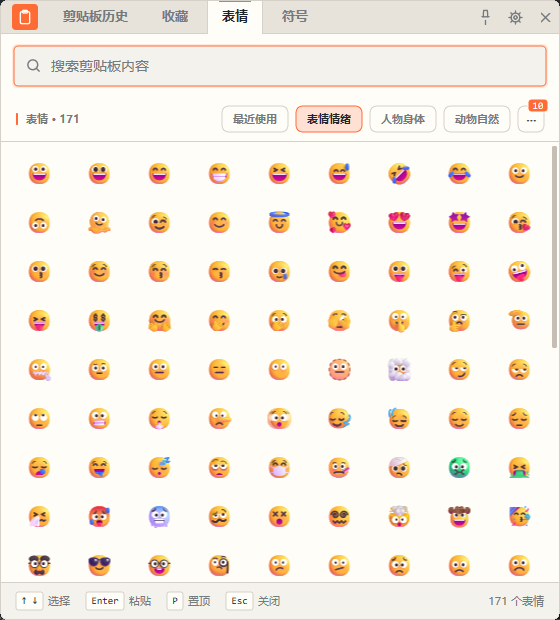

# WinVClip

**接管 Win+V 的剪贴板面板**——纯 Win32 C++ 自绘，唯一的第三方代码是 vendored 的
SQLite（`third_party/sqlite3.c`，公共领域单文件，用来存历史）。按下 Win+V 弹出的是它自己的面板，
系统自带的命令板不再出现。



| | |
|---|---|
| **四个页签** | 剪贴板历史 / 收藏 / Emoji / Unicode 符号，见下节 |
| **两种插入通道** | 目标有文本插入符 → `KEYEVENTF_UNICODE` 直插（不碰剪贴板）；读不到插入符（Chromium/Electron、终端、shell 列表）→ 借剪贴板 + `Ctrl+V` 后还原 |
| **非激活面板** | `WS_EX_NOACTIVATE` + 从不 `SetForegroundWindow`，键盘输入由低级钩子旁路转发；唯一会激活面板的是「点搜索框」（输入法需要真焦点） |
| **贴插入符弹出** | 原生窗口读 `GetGUIThreadInfo`，Chromium/Electron 走 UIA 文本模式；落点在 6 个候选位置里按「不遮挡输入框 > 在屏内 > 遮挡面积小」打分 |
| **能滚得动 9000+ 字形** | emoji 预渲染成磁盘图集（约 19MB）+ 后台预热 + 视口优先队列，热缓存下 2~3ms/帧 |

## 页签

| 页签 | 内容 |
|---|---|
| 剪贴板 | 文本 / 文件 / 图片，置顶项排最前 |
| 收藏 | 按 `Ctrl+D` 收藏的条目，粘贴走剪贴板通道 |
| 表情 | Emoji 全部条目，9 个分类 + 最近，彩色渲染；点一下直接插入目标窗口 |
| 符号 | Unicode 符号库，9 个大类 + 最近；字体覆盖不到的字形不显示 |

## 工作方式

1. **拦截**：`RegisterHotKey(MOD_WIN,'V')` 在系统剪贴板历史开启时必然返回「已被注册」，
   所以用 `WH_KEYBOARD_LL` 低级钩子识别「Win 按住 + V 按下」。吞掉事件后注入一个无害键
   `VK_NONAME`——否则系统认为 Win 一直按着，开始菜单会弹、注入的 Ctrl+V 会变成 Win+Ctrl+V。
2. **弹出**：面板是 `WS_EX_NOACTIVATE` 窗口，从不 `SetForegroundWindow` / `SetFocus`，
   鼠标点它也不激活（`MA_NOACTIVATE`）。目标窗口一直持有键盘焦点，真插入符一直闪。
3. **收起**：非激活窗口收不到 `WA_INACTIVE`，所以 120ms 轮询前台是否还是唤起时那个窗口；
   另配一个低级鼠标钩子，判「按下的点落在面板矩形之外」——两条判据互补，前者管切走应用，
   后者管在同一个窗口里点掉面板。
4. **插入**：有插入符直插、无插入符借剪贴板（见上表）。

## 快速开始

要求 MinGW-w64 g++（C++17）、CMake、Ninja：

```bat
cmake -G Ninja -B build -DCMAKE_BUILD_TYPE=Release
cmake --build build
build\winvclip.exe            :: 常驻托盘，按 Win+V 弹面板
build\winvclip.exe --show     :: 启动后立刻弹一次（调试用）
```

发布用的单文件 exe 要额外打开静态运行时，否则发到没装 MSYS2 的机器会缺 `libstdc++-6.dll`：

```bat
cmake -G Ninja -B build -DCMAKE_BUILD_TYPE=Release -DWINVCLIP_STATIC_RUNTIME=ON -DWINVCLIP_VERSION=1.2.3
```

`-municode` 必须同时出现在编译和链接选项里，否则链接期找不到 `WinMain`。
`src/glyph/glyph_data.cpp`（字形库，~840KB 字面量）已生成好并入库，日常编译不用管它；
换 Unicode 数据时才用 `python tools/gen_glyph_data.py <参考数据目录> src` 重新生成。

想开机自启：把 exe 的快捷方式丢进 `shell:startup`。单实例运行（互斥体 `WinVClip_SingleInstance`），
不写任何注册表，托盘右键退出后系统剪贴板历史与 Win+V 立刻恢复原样。

## 下载与发布

正式版本见 [Releases](https://github.com/nihaozyj7/WinVClip/releases)：下 `WinVClip-<版本>-win64.zip`
（或单个 `WinVClip-<版本>.exe`），解压双击即可，静态链接、不需要 .NET 或任何运行库。

发布是全自动的，由 [`.github/workflows/release.yml`](.github/workflows/release.yml) 完成：
推 `v*` tag 或在 Actions 页面手动 Run workflow（填版本号）→ 用 MSYS2 的 MinGW-w64 构建 →
校验产物 → 建 Release。维护者一键发布：

```bat
tools\release.bat 1.0.0       :: 检查工作树干净 -> 打 tag -> 推送，剩下交给 Actions
```

CI 只做能自动判定的检查：exe 的 `VERSIONINFO` 必须等于 tag 版本、导入表里不许出现
`libstdc++` / `libgcc` / `libwinpthread`（防静态链接被改回动态）、打包并生成 SHA-256。
`tests/` 那套是真桌面交互回归（真窗口、钩子、剪贴板），runner 上没有可交互桌面，跑出来只会是假失败，
所以**发布前请在本地跑 `python tests\run.py`**。

## 用法

托盘图标：左键开/关面板，右键「打开面板 / 退出」。

| 操作 | 效果 |
|---|---|
| Win+V | 弹出 / 关闭面板 |
| 直接打字 | 实时过滤（标题 / 来源 / 类型 / 正文） |
| ↑ ↓ / PgUp PgDn | 移动选择、翻页 |
| Enter / 单击行 | 写回剪贴板并粘贴到原窗口 |
| 单击表情 / 符号 | 直接插入目标窗口（有插入符不碰剪贴板，否则借剪贴板粘贴） |
| Shift + 单击表情 / 符号 | 强制走剪贴板粘贴通道（注入失效时的手动兜底） |
| Tab、Ctrl+1~4 | 切页签（`Ctrl+1~4` 仅在点过搜索框的输入态可用，见下文） |
| Ctrl+P / Ctrl+D / Ctrl+S | 置顶 / 收藏 / 另存为当前行（同上，只在输入态可用） |
| Delete | 删除（弹确认层） |
| 右键行 | 置顶 / 取消置顶、另存为…、删除 |
| 拖标题栏空白处 / 拖边缘角落 | 移动面板 / 改变尺寸（最小 360×340，松手即记忆） |
| 标题栏图钉 | 临时固定：置顶 + 失焦不收起，可连续插入多个条目 |
| Esc / 点别处 | 关闭（抽屉打开时 Esc 先收抽屉） |

记录类型：文本、文件（多选算一条）、图片（PNG 或 DIB，记尺寸）。条数上限可在设置里调
（默认 500，范围 50~5000），重复内容自动去重并提到最前；历史、置顶、收藏、表情/符号的「最近使用」
都落盘保存，重启后还在（位置见「已知限制」第一条）。

**接管范围刻意收窄**：非激活态只吞面板自己会消费的键（Esc、Tab、列表导航、Enter/Delete、裸字符），
所有 Ctrl/Alt/Win 组合与功能键一律放行——低级钩子是串行链，`return 1` 会饿死排在后面的别家全局热键
（AutoHotkey、Quicker、输入法热键）。代价是上面那些 Ctrl 快捷键只能在输入态用。

## 目录与文档

```
src/      C++ 源码，按层分目录（core → render/image/glyph → clipboard/model → ui → app）
tests/    回归测试，纯 Python 标准库
tools/    一次性诊断/测量/生成脚本，不属于构建
docs/     设计文档与截图
build/    构建产物（不入库）
```

| 文档 | 讲什么 |
|---|---|
| [docs/ARCHITECTURE.md](docs/ARCHITECTURE.md) | 分层与依赖方向、「我要改 X 该动哪个文件」、跨模块约定 |
| [docs/IMPLEMENTATION-NOTES.md](docs/IMPLEMENTATION-NOTES.md) | **改代码必读**：钩子/焦点/插入符/渲染/字形里每一条「为什么必须这样写」和踩过的坑 |
| [tests/README.md](tests/README.md) | 怎么跑、分组规则、写新用例的约定、已知的假失败 |
| [docs/CODE_REVIEW.md](docs/CODE_REVIEW.md) | 代码审查记录 |

```bat
cmake --build build        :: 要求零警告
python tests\run.py        :: desktop 组，约 100 秒
```

## 已知限制

- 目标窗口以管理员权限运行时，普通权限的本程序既收不到它的按键（UIPI）也注入不进去；要覆盖这类窗口
  只能以管理员身份运行本程序。UAC 安全桌面、锁屏下钩子天然不生效。
- 历史**明文**存在 `<临时目录>\history\history.db`（SQLite，图片像素在同目录的 `img\` 下），
  所以复制过的密码、Token 也会落在这个文件里。介意的话把「临时文件目录」指到加密盘，
  或把历史上限调到最小；删掉整个 `history` 目录即彻底清空历史。
- 历史只保留最近 `记录上限` 条（默认 500）；超过 16KB 的文本正文只存在数据库里，
  内存里按需读取，所以列表里能搜到、能粘贴，但正文不会常驻内存。
- 临时目录被改到不可写的路径（盘符拔掉、无权限）时会退回默认目录，那边是另一份历史。
- 注入偶尔失效（控件只认粘贴消息、IME 正在组字）：按 **Shift + 点击** 强制走粘贴通道。
- 本机字体画不出来的字形（如 Emoji 18.0 新增的少数表情）直接不显示，不画成方框，也不占空格子。
- 面板尺寸松手即记住（存在 `%LOCALAPPDATA%\WinVClip\view-size.txt`）；删掉这个文件回到默认 `560×620`。
- 图片行显示 36px 缩略图（保持原图宽高比）；4K 图首次显示要解码一次，几十毫秒。
- 标题栏齿轮钮打开**设置窗口**（独立窗口，无系统边框、标题栏自绘，按住标题行即可拖动，
   可在任务栏里找到）：开机自启、管理员模式、
  主题、临时目录、记录上限、删除前确认、清空历史。托盘右键菜单也有「打开剪贴板 / 设置 / 退出」三项。
  打开设置时面板会自动收起，反之按 `Win+V` 弹面板会把设置窗口关掉。
- 面板不抢焦点，目标窗口的插入符全程是真光标；唯一例外是用户主动点了搜索框（输入态），
  此时真光标暂时消失，`Esc` 或关面板即恢复。

## 常见问题

**面板为什么每次都出现在不同位置？** 它贴着目标窗口的文本插入符弹出（下方 8px，放不下往上翻，
再不行放左右，并尽量不压住输入框）。读不到插入符时（桌面、文件列表）居中于鼠标所在显示器；
Chromium/Electron 里可能先按「框内首行」近似弹出，随后 140ms 内校正位置。

**按 `Ctrl+1~4` / `Ctrl+D` 没反应？** 这些组合在非激活态被刻意放行给前台程序了（否则会抢走别人的
`Ctrl+S`/`Ctrl+C`）。点一下搜索框进入输入态后即可用，或直接用 `Tab` 切页签。

**点表情/符号什么都没插进去？** 该控件可能只认粘贴消息，或输入法正在组字：按住 **Shift** 再点，
强制走剪贴板粘贴通道。目标程序以管理员权限运行时无解，只能以管理员身份运行本程序。

**会不会影响 AutoHotkey / Quicker 的全局热键？** 不会——非激活态只吞面板自己会消费的键，带
Ctrl/Alt/Win 的组合与功能键全部放行。这条是被回归用例 `test_hook_passthrough.py` 盯住的。

**系统自带的 Win+V 呢？** 被接管，原生命令板不会出现。退出本程序（托盘右键退出）后立刻恢复原样，
程序不写任何注册表。

## 许可

MIT License，见 [LICENSE](LICENSE)。
